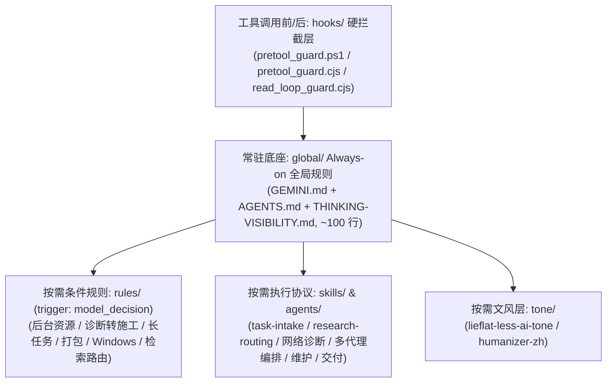

# Antigravity Agent Rules

这是一套给 Google Antigravity 桌面端（IDE / 2.0）& agy CLI 用的跨平台 Agent 分层规则、底层命令拦截 Hook、去 AI 味文风与按需 Skill 配置（已在 Gemini 4 Argon、Claude Opus 5.5 与 Gemini 3.8 Flash 上长期实测；含针对 2026-11-10 上线的 Gemini 4 Carbon 与 `/swarm` 多代理并行的初步适配）。

重度用 Agent 写代码或排障时，常会遇到它自作主张闯祸：诊断网络报错时顺手误杀本地代理软件、停掉 TUN 虚拟网卡服务或篡改系统代理注册表导致直接断网，或者误执行 `rm -rf`、`git reset --hard` 把未提交的代码抹掉。光在提示词里写“不许删文件、不许动代理”并不稳，上下文一长模型就会忘。这套配置把高危命令放到进程级 Hook 里硬拦，再把常驻规则、专项规则、文风和执行协议按层拆开按需加载。

除了防误删和防断网，它也管住另外几类常见毛病：根因确认后还反复读同一段代码不肯动刀，普通问答硬套故障排查模板或顺手改无关代码，拿示意图和伪代码冒充成品交差，只跑通一条静态路径就报全量验证通过（混淆 `VERIFIED` 与 `NOT_PROVEN`），随手拉起后台进程挂死终端或拿上千行构建日志刷爆主会话，在文档和脚本里带出 `C:\Users\<用户名>\...` 本机路径，以及写中文时满篇套话和翻译腔。

> 历史溯源：首版最早发在百度贴吧谷歌gemini吧（2026-09-29），之后由安钰与共创者 [len (LEN5010)](https://github.com/LEN5010) 在日常工程和跨平台实践中不断迭代定型。感谢 [LINUX DO 社区](https://linux.do/) 的开源交流氛围与佬友支持。

> [!WARNING]
> 使用前请注意以下四点边界：
> 1. **支持 Windows、macOS 与 Linux 全平台一键部署**：Windows 使用 [`install.ps1`](./install.ps1)（兼容 PowerShell 5.1 / `pwsh` 7，挂载 `pretool_guard.ps1`），macOS / Linux 使用 [`./install.sh`](./install.sh)（基于 Node.js >= 18，挂载跨平台 `pretool_guard.cjs`）。两端均默认执行 **5 层全量安装**，也都支持 `-HookOnly` / `--hook-only` 仅装 Hook 层。
> 2. **正则黑名单是安全网，不是沙箱，可以被绕过**。它已覆盖 `git -C` 全局参数穿透、`rm -r`、`find -delete`、`git checkout -- .`、`git restore .`、`git push origin +main`、`bash -c`/`python -c`/`node -e` 单行删除及上下文数据引号掩码（避免 `grep "rm -rf"` 或 `git commit -m "...rm -rf..."` 误拦），但本质仍是正则匹配，不能替代容器或 OS 级权限隔离。
> 3. **Hook 默认返回 `ask` + 两档拦截 + 日志脱敏**：`pretool_guard.ps1` / `pretool_guard.cjs` 对未命中高危黑名单的命令**默认返回 `{"decision":"ask"}`**。按 Antigravity 当前的 [Hooks 文档](https://antigravity.google/docs/hooks)，`ask` 是向用户请求确认（“始终允许”名单内的命令除外），`allow` 才是不干预、交给下一个 Hook 或宿主默认审批策略，直接批准的是 `auto_approve`；较早版本的文档对 `allow` 的描述不同，**实际行为以你安装的客户端版本为准**。改默认值前请在真机上把 `ask` 和 `allow` 各试一次，再写进脚本同目录的 `pretool_guard_settings.json`（见下文「拦什么、放什么」；环境变量 `AGY_HOOK_DEFAULT_DECISION` 仍然优先，但从 Dock / 开始菜单启动的客户端通常读不到 shell 里设的环境变量）。命中黑名单的命令分 block / confirm 两档，**默认两档都返回 `deny`**。审计日志 `hook_log.jsonl` **默认只记录被标记（`DENY-DANGER` / `CONFIRM-DANGER`）与解析故障（`ERROR-FAILOPEN`）事件**，不记录日常放行命令，且落盘前自动将命令行中的 Token、密码与 API Key 脱敏为 `<REDACTED>`。
> 4. 不要把本仓库所有 `.md` 文件拼接塞进同一个系统提示词（System Prompt / `GEMINI.md`）全量常驻。大模型有效注意力有限，全设为 `always_on` 不但白占数万 Token 推理空间，日常聊句简单问答也会触发繁琐的工程仪式并冲淡安全红线。正确用法是只让 `global/` 下约 100 行核心规则常驻，高危命令交给 `hooks/` 在进程级拦截（0 Token 开销），其余 `rules/`、`tone/` 和 `skills/` 由模型按场景触发读取。

---

## 快速安装与卸载

仓库根目录提供了 Windows 版的 [`install.ps1`](./install.ps1) / [`uninstall.ps1`](./uninstall.ps1)（兼容 Windows PowerShell 5.1 与 `pwsh` 7）以及 macOS / Linux 版的 [`install.sh`](./install.sh) / [`uninstall.sh`](./uninstall.sh)（驱动零依赖的 [`hooks/unix/hooks-installer.mjs`](./hooks/unix/hooks-installer.mjs)）。

### Windows（PowerShell 5.1 / `pwsh` 7）

```powershell
# 一键全量安装 5 层配置并自动跑完 193 项 Hook 离线回归自检（自动化环境跳过确认可加 -Force）
powershell -NoProfile -ExecutionPolicy Bypass -File .\install.ps1

# 只装 Hook（防强删 + 代理/网络保护），不动 GEMINI.md、config.json 和规则/Skill/文风层
powershell -NoProfile -ExecutionPolicy Bypass -File .\install.ps1 -HookOnly

# 一键卸载并还原到安装前状态（同样支持 -Force）
powershell -NoProfile -ExecutionPolicy Bypass -File .\uninstall.ps1
```

### macOS / Linux（Node.js >= 18）

```bash
# 一键全量安装 5 层配置并自动跑完 241 项 Hook 离线回归自检（跳过确认可加 --force，指定工作区可加 --workspace-path DIR）
./install.sh

# 只装 Hook 层（等价于 Windows 的 install.ps1 -HookOnly）
./install.sh --hook-only

# 一键卸载并从最近一次备份完整还原（自动识别 full / hook-only 模式，支持 --force）
./uninstall.sh
```

安装脚本（`install.ps1` 与 `./install.sh`）均按以下 5 步执行：
1. 校验：先解析现有 `~/.gemini/config/config.json` 与 `hooks.json` 语法，解析失败直接报错退出，不留半成品状态。
2. 确认：列出 `~/.gemini` 下即将被合并或覆盖的文件/目录，等你输入 `y` 确认后才继续（默认否，加 `-Force` / `--force` 可跳过）。
3. 备份：把安装前已存在的文件与目录完整备份到 `~/.gemini/backup_antigravity_rules_<timestamp>/`，同时记录 `manifest.json`（含 `mode: full | hook-only`）。
4. 无损合并与分发：合并 `GEMINI.md` 与 `hooks.json`，将 `file:///<YOUR_PATH>/.gemini/` 链接占位符替换为当前用户家目录正斜杠路径，分发 5 层文件（5 个插件 + 2 个独立 Skills）并在 `config.json` 中启用 5 个插件。
5. 脚本回归自检：自动运行 `verify-hook.py` 验证全部断言通过（Windows PowerShell 守卫 193 项，macOS / Linux Node 守卫 241 项，含密钥脱敏与零 `ERROR-FAILOPEN` 校验）。

只想要拦截功能、不想换掉自己的规则，就用 `-HookOnly`（Windows）或 `--hook-only`（macOS / Linux）：只合并 `hooks.json` 并部署 `scripts/`，第 4 步里的 `GEMINI.md`、插件和 `config.json` 全部跳过，自检照常运行。卸载脚本会从备份的 `manifest.json` 自动识别 `full` 或 `hook-only` 模式，按对应范围还原。

<details>
<summary>点击展开：无损合并与占位符替换细节</summary>

- `GEMINI.md`：用 `<!-- antigravity-agent-rules:begin -->` 与 `<!-- antigravity-agent-rules:end -->` 标记包裹本仓库规则追加到文件末尾；若已有标记则只替换标记之间的内容，保留你原有的内容。通用规则已移除个人笔名与项目专属占位符，开箱即可直接作为通用配置使用。
- `hooks.json`：按顶层键合并，只新增或替换 `hard-gate`、`read-loop-efficiency`、`read-loop-enforcement` 三个键，保留你原有的其他钩子配置。
- 路径占位符替换：把规则链接里的 `<YOUR_PATH>` 自动替换为当前用户的家目录正斜杠路径（Windows 为 `$env:USERPROFILE`，macOS / Linux 为 `$HOME`，同时在 Unix 下将路径前缀 `%USERPROFILE%\...` 转为 `$HOME/...`）；若传入 `-WorkspacePath "D:\MyProject"` 或 `--workspace-path "/path/to/project"`，还会将独立 Skills 同步复制到工作区 `.agents/skills/`。

</details>

卸载脚本（`uninstall.ps1` 与 `./uninstall.sh`）经 `y` 确认后，从最近一次 `~/.gemini/backup_antigravity_rules_*` 还原安装前已存在的文件与目录，删掉安装时新建的脚本与插件目录，并在 `~/.gemini/config/config.json` 中只移除本仓库的 5 个插件条目（`anyi-global-rules`、`search-routing`、`docx-delivery`、`lieflat-less-ai-tone`、`humanizer-zh`），保留其余配置。

### macOS / Linux 跨平台安装与守卫细节

依据 Antigravity Hooks 协议规范，macOS / Linux 版与 Windows 版使用同一套 `~/.gemini` 目录结构与生命周期钩子协议（payload 和 `{"decision": ...}` 返回格式一致，区别仅在于 hook 命令在 Unix 上经 `sh -c` 执行，Windows 上经 `cmd /c` 执行）：

- 拦截脚本使用 [`hooks/scripts/pretool_guard.cjs`](./hooks/scripts/pretool_guard.cjs)。通用/Windows 规则与 `pretool_guard.ps1` 逐条同步，另外补齐了 17 条 macOS / Linux 专属规则：磁盘与系统完整性保护（`diskutil erase*`、`dd of=/dev/`、`mkfs` / `newfs_*`、`tmutil delete`、`csrutil disable`）；结束代理客户端（`kill` / `pkill` / `killall`、`launchctl bootout/unload`、`systemctl stop`、`osascript ... quit`，覆盖 ClashX、Clash Verge、mihomo、sing-box、Surge、Stash 等）；修改网络与系统代理（`networksetup -set*`、`ifconfig ... down`、`ipconfig set`、`route delete/flush/change`、`pfctl -d/-F`、`nmcli ... off/down`）。只读诊断命令（`networksetup -get*`、`scutil --proxy`、`pgrep`、`launchctl list`、`diskutil list`）照常返回 `ask`。
- 安装器会把 `hooks.json` 里的命令改写成 `"/opt/homebrew/bin/node" ./scripts/pretool_guard.cjs` 这种绝对路径形式。原因是从 Dock 或桌面启动器拉起的 Antigravity 不一定继承终端里的 PATH，直接写 `node` 可能找不到。
- PowerShell 5.1 的 GBK 编码问题在 macOS / Linux 上不存在：Node 版按原始字节读 stdin 并按 UTF-8 解码。
- `global/GEMINI.md` 与 `skills/safe-network-diagnostics/SKILL.md` 已内置 Windows / macOS / Linux 三端分流的 Shell 偏好（Windows 用 Git Bash / `pwsh` 7，macOS / Linux 用原生 `zsh` / `bash`）及三端只读网络诊断命令对照（`scutil --proxy`、`networksetup -get*`、`lsof`、`ss -tulnp`、`ip addr` 等）。

---

## Hook 层重点说明

### 1. 拦什么、放什么（上下文引号掩码与防漏拦/误拦）

[`hooks/scripts/pretool_guard.ps1`](./hooks/scripts/pretool_guard.ps1)（Windows）与 [`hooks/scripts/pretool_guard.cjs`](./hooks/scripts/pretool_guard.cjs)（macOS / Linux）挂载在 `PreToolUse` 上，每次 `run_command` 执行前同步触发：

- **上下文数据引号掩码（防误拦）**：在执行正则匹配前，先对搜索/输出命令（`grep`/`egrep`/`fgrep`/`rg`/`ag`/`ack`/`sed`/`Select-String`/`echo`/`printf`/`Write-Host`）及 Git 提交说明（`git commit`/`tag`/`notes`/`merge` 的 `-m "..."`）中不含 `$(` 或反引号命令替换的单双引号字面量做掩码剥离，因此 `grep -rn "rm -rf" scripts/`、`git commit -m "fix rm -rf check"` 不会被误判拦截；而 `grep "rm -rf" a.txt && rm -rf build` 或 `bash -c "rm -rf /tmp/x"` 中的真实删除仍会被精准拦下。打印出的文本一旦会被当成代码执行，就不做掩码：`echo 'rm -rf src' | sh`、`printf ... | bash`，以及命令行里出现 `$(...)`、反引号或 `eval` 时的 `echo` / `printf`。
- **高危删改与历史破坏拦截（防漏拦）**：
  - 递归目录删除：`Remove-Item -Recurse`（含无 `-Force` 形式及 `ri`/`rm`/`del`/`rd`/`rmdir` 短参数）、`rm -r` / `rm -R` / `rm -rf` / `rm --recursive`（含不带 `-f` 的 `rm -r build`）、`find ... -delete` / `-exec rm`、`rd /s`、`rmdir /s`、`del /f`/`/s`、以及 `python -c "shutil.rmtree(...)"` / `node -e "fs.rmSync(..., {recursive:true})"` 单行解释器递归删除（解释器里删单个文件与 `rm <file>` 一样不标记）。带路径的可执行文件按同一条命令处理（`/bin/rm -rf`、`\rm -rf`、`/usr/bin/git reset --hard`、`"C:\...\git.exe" reset --hard`）；`git rm`、`pnpm rm`、`docker rm` 这类子命令不当作文件删除。
  - Git 历史与工作区破坏（支持 `git -C <dir>`、`-c k=v`、`--git-dir`、`--work-tree` 等全局选项穿透）：拦截 `git reset --hard`、`git clean -fd`/`-f`、`git checkout -- .` / `git checkout -f`、`git restore .` / `git restore --worktree`（放行仅取消暂存的 `git restore --staged .`）、以及 `git push --force` / `-f` / `git push origin +main`（同时**放行安全的 `git push --force-with-lease` 与 `--force-if-includes`**）。同样标记不带 `--` 的 `git checkout .`、整目录的 `git checkout -- src/` / `git restore src/`、`git restore -s <rev> .`、`git stash drop` / `clear`、`git switch --discard-changes`、`git rm -f`；放行 `git clean -n` / `--dry-run` 预演与 `git rm --cached`。
  - 磁盘与注册表破坏：`Format-Volume`、`format C:`、`Clear-Disk`、`Initialize-Disk`、`Remove-Item HKLM:`、`reg delete`。
- **代理与网络配置只读保护**：拦截结束本地代理进程（`taskkill`/`Stop-Process`/`pkill`/`killall` 等针对 Clash、mihomo、sing-box、v2ray、xray、Surge、Stash 等）、停止虚拟网卡或代理服务（`sc stop`/`Stop-Service`/`launchctl`/`systemctl`）、断网删路由（`netsh wlan disconnect`、`Disable-NetAdapter`、`ipconfig /release`、`route delete`、`ifconfig down`、`nmcli`、`pfctl`）及篡改系统代理设置（`Internet Settings` 注册表、`netsh winhttp set proxy`、`networksetup -set*`）。

命中黑名单的命令分两档：

- **block 档**：不可逆、且不可能发生在工作区内的操作——格式化或重建磁盘、删除文件系统根目录 / 盘符根 / 家目录 / 系统目录（`rm -rf /`、`rm -rf ~`、`Remove-Item C:\ -Recurse`、`rd /s /q C:\Users`）、从 `/` 或 `~` 起 `find ... -delete`。恒定返回 `{"decision":"deny","reason":"HARD GATE: blocked - ..."}`，任何设置都改不了。
- **confirm 档**：其余全部规则——工作区内的递归删除、Git 破坏性操作、注册表删除、代理与网络操作。返回 `confirmDecision`，**默认是 `deny`，与之前的行为一致**；设为 `force_ask` 后改为每次弹出确认（返回 `{"decision":"force_ask","reason":"CONFIRM: ..."}`），`rm -r dist`、`git reset --hard` 这类有时确实想执行的命令由用户当场决定。

**未命中黑名单的命令默认返回 `{"decision":"ask"}`**。两个默认值都可以在可选的 `pretool_guard_settings.json` 里改。该文件与守卫脚本同目录（`~/.gemini/config/scripts/`），仓库不自带，重新安装不会覆盖，卸载也不会删除：

```json
{
  "defaultDecision": "ask",
  "confirmDecision": "force_ask",
  "logAll": false
}
```

| 键 | 可选值 | 默认 | 含义 |
| :--- | :--- | :--- | :--- |
| `defaultDecision` | `ask` / `allow` | `ask` | 未命中黑名单的命令返回什么 |
| `confirmDecision` | `deny` / `force_ask` / `ask` | `deny` | confirm 档返回什么；无法设成 `allow` |
| `logAll` | `true` / `false` | `false` | 是否把未命中的命令也写进日志 |

环境变量 `AGY_HOOK_DEFAULT_DECISION` / `AGY_HOOK_CONFIRM_DECISION` / `AGY_HOOK_LOG_ALL` 优先于文件，`AGY_HOOK_SETTINGS` 可指向另一份设置文件。文件缺失、JSON 损坏或取值无效时，一律回落到最严格的默认值（`ask` / `deny`）。`force_ask` 在 `/swarm` 后台 Worker 等无人应答场景下的宿主行为尚未在真机验证（`NOT_PROVEN`），所以没有把它设为默认。

审计日志 `hook_log.jsonl` 默认仅记录 `DENY-DANGER`、`CONFIRM-DANGER` 与 `ERROR-FAILOPEN`（不记录日常放行命令，除非开启 `logAll`），并在写入前对命令行中的 Bearer Token、`sk-*`/`ghp_*`/`AIza*`、`--token`/`--password`/`API_KEY=` 等敏感凭据做正则脱敏。

另外还有 [`hooks/scripts/read_loop_guard.cjs`](./hooks/scripts/read_loop_guard.cjs)（配合 [`read_loop_settings.json`](./hooks/scripts/read_loop_settings.json)），用来监测同一会话对未变更文件相同行号区间的重复读取（`repeatLimit: 3`），当前默认只跑在 `PostToolUse` 的 `observe` 模式，`enforce` 阻断模式标 `NOT_PROVEN`。

### 2. PS5.1 GBK 吞反斜杠导致静默放行的 Bug 与修复

因为同步 Hook 一旦抛错就会卡死整个 Agent 工具链，`pretool_guard.ps1` 的 `catch` 分支采用了 Fail-open 设计（内部报错时返回默认决策并记录 `ERROR-FAILOPEN`）。这在中文 Windows 的 PowerShell 5.1 下曾踩过一个隐蔽的编码坑：

Antigravity 往 Hook 的 `stdin` 发送的是原始 UTF-8 字节流，但中文 Windows 上的 PowerShell 5.1 默认用控制台 OEM 代码页（GBK / 936）解码 `[Console]::In`。载荷里一旦包含中文路径（例如 `C:\Users\<中文用户名>\...`），非 ASCII 字节就会被按 GBK 解乱，紧跟在反斜杠 `\` 后面的字节可能被前一个字节吸进双字节 GBK 字符里，直接把合法的 JSON 转义吞掉，导致 `ConvertFrom-Json` 报错跳进 `catch` 分支。

修复方式分两步：
1. 脚本源码本身保持纯 ASCII，避开 PowerShell 5.1 将无 BOM 脚本按 ANSI 解析时的非 ASCII 路径故障。
2. 不使用 `[Console]::In`，改用 `[Console]::OpenStandardInput()` 搭配显式的 `New-Object System.Text.UTF8Encoding($false)` 流解码器读取原始 `stdin`，输出时同样用 `UTF8Encoding($false)` 写回 `[Console]::OpenStandardOutput()`，绕开控制台 GBK 代码页。

### 3. 离线脚本回归自检（`verify-hook.py`）与宿主真机挂载验证

每次修改 `pretool_guard.ps1` 或 `pretool_guard.cjs` 后，运行 [`hooks/scripts/verify-hook.py`](./hooks/scripts/verify-hook.py) 可执行全量离线回归校验（Windows PowerShell 守卫 **193 项**，macOS / Linux Node 守卫 **241 项**）：

```bash
python ~/.gemini/config/scripts/verify-hook.py                # Windows 默认测 PS 版 (193 项)
python ~/.gemini/config/scripts/verify-hook.py --guard node   # 测跨平台 Node 版 (241 项)
```

跑完除了要求 `FAIL 0`、检查 `hook_log.jsonl` 中 `ERROR-FAILOPEN` 为 `0` 外，还会自动断言日常非拦截命令未被写入日志、且命令行中的测试密钥 `sk-secret...` 已被脱敏为 `<REDACTED>`。

> **注意区分「脚本离线自检」与「宿主真机挂载验证」**：`verify-hook.py` 是通过管道把构造好的 UTF-8 JSON 载荷喂给守卫脚本，只能证明脚本自身的正则、编码解析和脱敏逻辑工作正常（`SCRIPT_SELF_TEST_ONLY`），**不能直接证明 Antigravity 客户端进程已经加载并调用了 `hooks.json`**。安装完成并重启 Antigravity 后，建议在聊天窗口让 Agent 试跑一条无害的受控拦截探针（例如 `rm -r __nonexistent_hook_probe__`），确认工具调用被硬拦截且 `~/.gemini/config/scripts/hook_log.jsonl` 新增一条 `DENY-DANGER` 记录，才代表宿主端挂载真正生效（`VERIFIED`）。

---

## 五层架构



- `hooks/`（硬拦截层）：在工具调用前后由宿主直接调用，不占模型上下文 Token。`pretool_guard.ps1`（Windows）与 `pretool_guard.cjs`（macOS / Linux）在进程级拦住强删、丢代码和杀代理断网命令（非黑名单默认返回 `ask`，审计日志仅记拦截项并自动脱敏密钥），`read_loop_guard.cjs` 在 `observe` 模式下记录重复读同一文件区间的死循环。
- `global/`（Always-on 常驻底座）：只有 `GEMINI.md`、`AGENTS.md` 和 `THINKING-VISIBILITY.md` 三个文件常驻，共约 100 行。规定防开盒与路径脱敏、代理只读红线、按平台分流的 Shell 偏好（Windows 用 Git Bash / `pwsh` 7，macOS / Linux 用原生 `zsh` / `bash`）、工具调用前显式说明排查脉络、动作分级、`FAST_PATH` / `INVESTIGATION_PATH` 切换、证据分级（`VERIFIED` / `NOT_PROVEN` / `HYPOTHESIS`）以及专项规则路由。
- `rules/`（按需条件规则层）：带 `trigger: model_decision`，平时只向模型暴露一行触发条件描述。仅在涉及后台进程与 GUI 脱钩、诊断转施工判断、8 分钟长任务阶段汇报、打包发布、Windows 脚本编码或外部联网检索时按需加载。
- `skills/` 与 `agents/`（按需执行协议与子代理层）：存放多步骤工程状态机与四态回报（`task-intake`）、多源检索（`research-routing`）、只读网络排查（`safe-network-diagnostics`）、多代理与 `/swarm` 并行编排（`multi-agent-orchestrator`）、客户端缓存归档（`client-maintenance`）、Word 转换校验（`docx-delivery`）和小说创作（`chinese-novelist`）等标准作业程序，同时提供运行在 Gemini Flash 上的全局只读验证子代理 `flash-verifier.md` 来隔离长日志与哈希扫描脏活。
- `tone/`（按需文风层）：包含 `lieflat-less-ai-tone`（基于 283 万字语料统计的 11 条去 AI 味写作规范）和 `humanizer-zh`（去除空话、重复与模板腔）。平时问答与写代码不加载，只在创作或润色中文文章及用户点名去 AI 味时读取。

---

## 完整文件总表与手动部署步骤

<details>
<summary>点击展开：完整文件总表（29 项文件/模块与触发矩阵）</summary>

| 仓库内路径 | 原始部署路径（脱敏） | 所属层级 | 触发方式 | 一句话作用 |
| :--- | :--- | :--- | :--- | :--- |
| [`install.ps1`](./install.ps1) | 仓库根目录执行（Windows 一键部署入口） | 自动化部署 (`root`) | 手动执行（首次安装或更新规则时） | 预先校验 `config.json`/`hooks.json` 语法、列出待修改项并经 `y` 确认（支持 `-Force` / `-HookOnly`）、自动备份原配置、替换 `<YOUR_PATH>`、按标记/顶层键无损合并 `GEMINI.md` 与 `hooks.json`、分发 5 层文件、启用 5 个插件并跑通 `verify-hook.py` 193 项自检。 |
| [`uninstall.ps1`](./uninstall.ps1) | 仓库根目录执行（Windows 一键卸载回滚） | 自动化部署 (`root`) | 手动执行（卸载或还原配置时） | 经 `y` 确认后（支持 `-Force`），从最近一次 `backup_antigravity_rules_*` 还原安装前已存在的文件，删除安装前不存在的文件与插件目录，并仅从 `config.json` 移除本仓库的 5 个插件条目。 |
| [`install.sh`](./install.sh) / [`uninstall.sh`](./uninstall.sh) + [`hooks/unix/hooks-installer.mjs`](./hooks/unix/hooks-installer.mjs) | 仓库根目录执行（macOS / Linux 一键部署与卸载入口） | 自动化部署 (`root`) | 手动执行（macOS / Linux 全量安装、仅装 Hook 或卸载还原时） | 等价于 `install.ps1` / `uninstall.ps1` 的跨平台版（默认 5 层全量安装，支持 `--hook-only`、`--force`、`--workspace-path`）：预校验 `config.json`/`hooks.json`、备份、无损合并 `GEMINI.md` 与 `hooks.json`（改写 Node 绝对路径）、替换 `<YOUR_PATH>` 与 `%USERPROFILE%\`、分发 5 个插件与独立 Skills、启用 `config.json` 插件并跑通 `verify-hook.py --guard node` 241 项自检。 |
| [`hooks/hooks.json`](./hooks/hooks.json) | `~/.gemini/config/hooks.json` | 硬拦截 Hook (`hooks/`) | `PreToolUse` (`run_command`) / `PostToolUse` (读写检索工具) | 注册 `hard-gate` 危险命令硬拦截与 `read-loop` 重复读取检测钩子。 |
| [`hooks/scripts/pretool_guard.ps1`](./hooks/scripts/pretool_guard.ps1) | `~/.gemini/config/scripts/pretool_guard.ps1` | 硬拦截 Hook (`hooks/`) | `PreToolUse`（Windows 下每次 `run_command` 执行前同步触发） | 底层正则硬拦截递归删除（`rm -r`、`Remove-Item -Recurse`、`find -delete`、解释器单行删除）、`git -C` 全局选项下的 `reset --hard`/`push --force`/`+refspec`/`clean -fd`/`checkout -- .`/`restore .`、删注册表/格式化及杀代理断网命令；支持数据引号掩码防误拦，默认返回 `ask`，仅记录拦截日志并自动脱敏密钥。 |
| [`hooks/scripts/pretool_guard.cjs`](./hooks/scripts/pretool_guard.cjs) | `~/.gemini/config/scripts/pretool_guard.cjs` | 硬拦截 Hook (`hooks/`) | `PreToolUse`（macOS / Linux 安装时挂载） | `pretool_guard.ps1` 的 Node 跨平台版：通用规则与 PS 版逐条同步，另加 17 条 macOS / Linux 的磁盘、代理客户端与网络设置规则；同样默认返回 `ask` 并对拦截日志做密钥脱敏。 |
| [`hooks/scripts/read_loop_guard.cjs`](./hooks/scripts/read_loop_guard.cjs) | `~/.gemini/config/scripts/read_loop_guard.cjs` | 硬拦截 Hook (`hooks/`) | `PostToolUse`（默认 `observe`）/ `PreToolUse`（`enforce` 未启用） | 监测同一会话内对未变更文件相同行号区间的重复读取（兼容 `read_file`/`edit_file`/`write_file` 与旧版 `view_file` 等，含省略 `EndLine` 整文件读取及 5MB 日志自动轮转）。默认仅运行在 `observe` 模式；`enforce` 模式标 `NOT_PROVEN`。 |
| [`hooks/scripts/read_loop_settings.json`](./hooks/scripts/read_loop_settings.json) | `~/.gemini/config/scripts/read_loop_settings.json` | 硬拦截 Hook (`hooks/`) | 被 `read_loop_guard.cjs` 读取 | 配置重复读取检测模式（默认 `"mode": "observe"`，三个 Verified 标志均为 `false`，`enforce` 模式 `NOT_PROVEN`）与重复次数上限（`repeatLimit: 3`）。 |
| [`hooks/scripts/verify-hook.py`](./hooks/scripts/verify-hook.py) + [`test-cases.txt`](./hooks/scripts/test-cases.txt) | `~/.gemini/config/scripts/` | 硬拦截 Hook (`hooks/`) | 手动或安装时自动执行 | 用含中文路径的真实 UTF-8 载荷对 `pretool_guard.ps1`（193 项）与 `pretool_guard.cjs`（241 项）做全量离线回归校验，验证防漏拦、防误拦、密钥脱敏且 `ERROR-FAILOPEN` 为 `0`。 |
| [`global/GEMINI.md`](./global/GEMINI.md) | `~/.gemini/GEMINI.md` | Always-on 全局规则 (`global/`) | `always_on`（所有会话自动注入） | 定义人机协作态度、防开盒与路径脱敏铁律（默认不填入系统用户名/Git 账号名）、跨平台用户代理与网络配置严格只读红线、按平台分流的 Shell 偏好（Windows: Git Bash/`pwsh` 7；macOS/Linux: 原生 `zsh`/`bash`）、子代理派工原则与可选共享待办入口。 |
| [`global/AGENTS.md`](./global/AGENTS.md)（含 [`plugin.json`](./global/plugin.json)） | `~/.gemini/config/plugins/anyi-global-rules/rules/AGENTS.md` | Always-on 全局规则 (`global/`) | `trigger: always_on` | 全局工程主规则（§1–§15）：规定动作分级（主工作树修改 ≥5 个文件先问再动，`branch`/`share` 隔离 worktree 未合入主分支前豁免并留 Verifier 终审）、`FAST_PATH`/`INVESTIGATION_PATH` 轮次纪律、禁仪式化严谨、停止与资源边界、交付契约、证据真实性、数据保护、范围锁定及按需专项路由。 |
| [`global/THINKING-VISIBILITY.md`](./global/THINKING-VISIBILITY.md) | `~/.gemini/config/plugins/anyi-global-rules/rules/THINKING-VISIBILITY.md` | Always-on 全局规则 (`global/`) | `trigger: always_on` | 按运行模式区分思考可见性：主会话交互保留每次工具调用前 1–2 句前置判断；对 `/swarm` 并行执行 worker、`flash-verifier`、`research` 等后台子代理免除逐次工具前置播报，降低高单价输出开销与看板噪音。 |
| [`tone/lieflat-less-ai-tone/`](./tone/lieflat-less-ai-tone/skills/lieflat-less-ai-tone/SKILL.md) | `~/.gemini/config/plugins/lieflat-less-ai-tone/` | 文风层 (`tone/`) | 按需加载（创作或润色中文文章/文案/故事、或明确要求去 AI 味时；普通问答不加载） | 基于 283 万字语料统计的 11 条去 AI 味写作规范（与全局规则衔接版），清除宏大拔高、三连排比、翻译腔与连接词泛滥，严守事实与结构守恒（上游完整仓库见 [`UPSTREAM.md`](./tone/lieflat-less-ai-tone/UPSTREAM.md)）。 |
| [`tone/humanizer-zh/`](./tone/humanizer-zh/skills/humanizer-zh/SKILL.md) | `~/.gemini/config/plugins/humanizer-zh/` | 文风层 (`tone/`) | 按需加载（编辑或审阅已有中文文章/评论/文档、去除空话与模板化表达时） | 消除已有中文文本的空话、重复与模板腔，严格保留原文事实、确定程度与作者声音（上游仓库见 [`UPSTREAM.md`](./tone/humanizer-zh/UPSTREAM.md)）。 |
| [`rules/BACKGROUND-RESOURCES.md`](./rules/BACKGROUND-RESOURCES.md) | `~/.gemini/config/plugins/anyi-global-rules/rules/BACKGROUND-RESOURCES.md` | 按需 model-decision 规则 (`rules/`) | `trigger: model_decision`（创建/管理临时子代理、后台任务、测试服、子进程或拉起桌面 GUI 前） | 规定“谁创建谁负责生命周期”、创建记身份、探针用完即杀、桌面 GUI 脱钩启动、禁止按进程名盲杀用户原有服务，以及活跃施工子代理（≤2–3）与重型编译/渲染子进程并发硬上限（≤1–2）。 |
| [`rules/IMPLEMENTATION.md`](./rules/IMPLEMENTATION.md) | `~/.gemini/config/plugins/anyi-global-rules/rules/IMPLEMENTATION.md` | 按需 model-decision 规则 (`rules/`) | `trigger: model_decision`（判断证据是否已收敛、能否从诊断转入施工或控制前端 UI 信息密度时） | 细化全局 §2A 诊断→施工切换条件，防止只读调查空转；同时规定前端与 UI 交付密度约束（容器嵌套 ≤3 层、单行卡片 ≤3–4 个、单卡核心指标 ≤3 项，次要参数下沉抽屉）。 |
| [`rules/LONG-TASKS.md`](./rules/LONG-TASKS.md) | `~/.gemini/config/plugins/anyi-global-rules/rules/LONG-TASKS.md` | 按需 model-decision 规则 (`rules/`) | `trigger: model_decision`（距上次用户可见正文接近 8 分钟，或长任务卡点/重复失败时） | 细化全局 §4A 长任务阶段可见性（8 分钟墙钟阈值 / 60 次工具调用兜底），规范阶段汇报内容且不打断正常执行。 |
| [`rules/RELEASE-PACKAGING.md`](./rules/RELEASE-PACKAGING.md) | `~/.gemini/config/plugins/anyi-global-rules/rules/RELEASE-PACKAGING.md` | 按需 model-decision 规则 (`rules/`) | `trigger: model_decision`（构建、修改或验收 Release / 便携包 / 交付 ZIP 前） | 规定冻结基线定义、完整依赖闭包检查、独立新目录解压实跑验证与五态发布结论。 |
| [`rules/RULE-MAINTENANCE.md`](./rules/RULE-MAINTENANCE.md) | `~/.gemini/config/plugins/anyi-global-rules/rules/RULE-MAINTENANCE.md` | 按需 model-decision 规则 (`rules/`) | `trigger: model_decision`（新增、修改或评估本套全局治理规则时） | 细化全局 §14 规则冻结原则：禁止为单一失败样本扩写规则，明确新增条款必须同时满足的三项门槛。 |
| [`rules/WINDOWS-RELEASE.md`](./rules/WINDOWS-RELEASE.md) | `~/.gemini/config/plugins/anyi-global-rules/rules/WINDOWS-RELEASE.md` | 按需 model-decision 规则 (`rules/`) | `trigger: model_decision`（制作、修改或验证 Windows 脚本与中文交付物前） | 规范 BAT/CMD 纯 ASCII 编码、中文 TXT UTF-8 BOM 约定，以及启动/关闭脚本用目标解释器实跑验证的要求。 |
| [`rules/SEARCH-ROUTING.md`](./rules/SEARCH-ROUTING.md) | `~/.gemini/config/plugins/search-routing/rules/SEARCH-ROUTING.md` | 按需 model-decision 规则 (`rules/`) | `trigger: model_decision`（涉及时效信息、外部事实核验、库版本状态、官方文档或 URL 读取时） | 决定何时必须用 `search_web` 检索、何时用 `read_url_content` 直取、何时才用 Browser Agent 及失败降级规则。 |
| [`skills/task-intake/SKILL.md`](./skills/task-intake/SKILL.md) | `~/.gemini/config/plugins/anyi-global-rules/skills/task-intake/SKILL.md` | 按需 Skill (`skills/`) | 多步骤工程开发、复杂排障（`INVESTIGATION_PATH`）、生产变更、触发熔断或输出四态工程回报时 | 承载工程任务内部编译、状态标记总表（原全局 §7A）、只读空转熔断、独立 Review 与四态交付回报（`PASS`/`PASS_WITH_NOTES`/`BLOCKED`/`FAIL`）。 |
| [`skills/research-routing/SKILL.md`](./skills/research-routing/SKILL.md) | `~/.gemini/config/plugins/search-routing/skills/research-routing/SKILL.md` | 按需 Skill (`skills/`) | 触发 `SEARCH-ROUTING` 且需执行外部检索与多源核验时 | 规定双语查询构造、来源三级分类与交叉验证强度（第三方至少 2 独立源）、官方原文抓取与时效 `as-of` 标注 SOP。 |
| [`skills/safe-network-diagnostics/SKILL.md`](./skills/safe-network-diagnostics/SKILL.md) | `~/.gemini/config/plugins/anyi-global-rules/skills/safe-network-diagnostics/SKILL.md` | 按需 Skill (`skills/`) | 网络连通性排查、代理状态检查、DNS/端口探测或接口报错诊断时 | 固化跨平台用户代理只读红线，提供 Windows / macOS / Linux 三端只读代理查询、端口监听、DNS/网卡及假性流中断鉴别 SOP。 |
| [`skills/multi-agent-orchestrator/SKILL.md`](./skills/multi-agent-orchestrator/SKILL.md) | `~/.gemini/config/plugins/anyi-global-rules/skills/multi-agent-orchestrator/SKILL.md` | 按需 Skill (`skills/`) | 子代理分工、`/swarm`（`/teamwork`）并行协作、派 Flash 干只读验证/脏活、跨模块检索、隔离实验或跨端 MCP 协同任务时 | 规范主会话上下文保护、4c/4a 配额与档位分流、`/swarm` 并行互斥写入边界与隔离 worktree 批量修改豁免、并发 Worker 与重型构建子进程硬上限、内部 Subagent 选型及跨端 MCP 协同纪律。 |
| [`skills/client-maintenance/SKILL.md`](./skills/client-maintenance/SKILL.md) | `~/.gemini/antigravity/skills/client-maintenance/SKILL.md`（及可选 `<workspace>/.agents/skills/`） | 按需 Skill (`skills/`) | 清理 Antigravity 缓存、维护客户端存储空间或归档陈旧历史会话时 | 执行 7 天活跃会话与当前会话白名单保护、14 天以上陈旧会话压缩归档至 `_archives/` 并校验、以及临时渲染缓存安全释放。 |
| [`skills/docx-delivery/`](./skills/docx-delivery/skills/docx-delivery/SKILL.md) | `~/.gemini/config/plugins/docx-delivery/` | 按需 Skill (`skills/`) | 用户要求将 Markdown/文本/报告转换为可编辑的 Word (`.docx`) 成品时 | 提供两条实战验证的转换链（无图版 `md2docx_one.py` / 带图版 `md2docx_img.py`）、防覆盖保护与 `validate_docx.py` 校验；区分既有文本原样转换与 Agent（如 Carbon）撰稿的对外文档交付（转 `.docx` 前默认串联 `humanizer-zh` 或交由 Argon 润色）。 |
| [`skills/chinese-novelist/`](./skills/chinese-novelist/SKILL.md) | `~/.gemini/antigravity/skills/chinese-novelist/`（及可选 `<workspace>/.agents/skills/`） | 按需 Skill (`skills/`) | 用户要求分章节创作中文中长篇小说（10–50 章）或续写小说项目时 | 与全局规则（§4A 阶段汇报、覆盖前备份、`lieflat-less-ai-tone` 自检、分块 `write_file`）衔接的小说创作入口（上游完整流程与脚本见 [`UPSTREAM.md`](./skills/chinese-novelist/UPSTREAM.md)）。 |
| [`agents/flash-verifier.md`](./agents/flash-verifier.md) | `~/.gemini/config/plugins/anyi-global-rules/agents/flash-verifier.md` | 按需全局 Subagent (`agents/`) | `invoke_subagent(TypeName="flash-verifier")`（跑只读扫描、核对哈希、筛长日志时委派） | 运行在 Gemini Flash 上的全局只读验证专员定义，强制纯只读、单条回复 ≤40 行、大输出落盘 `scratch/`。 |
| [`mcp/dsh-bridge/`](./mcp/dsh-bridge/) & [`mcp/agent-bridge/`](./mcp/agent-bridge/) | 按需注册至 Antigravity MCP 配置 | 可选跨端 MCP 桥 (`mcp/`) | 跨端委派外部 CLI Agent（如 DSH Headless）执行只读或开发任务时 | 零依赖 Node.js MCP stdio 桥（`dsh-bridge` 原名 `dsh-crew`，已改名避免与社区 `ZSeven-W/dsh-crew` 冲突并默认 `read-only`，完成 Windows/macOS 适配与真机验证；`agent-bridge` 为通用可插拔桥，通过 32/32 假后端协议自检）。 |

</details>

<details>
<summary>点击展开：按层手动部署步骤</summary>

若需手动选择性部署，请先将文件中 `file:///<YOUR_PATH>/.gemini/...` 链接里的 `<YOUR_PATH>` 替换为你本机的家目录正斜杠路径（或直接使用 `install.ps1` / `./install.sh` 自动替换）。

> 关于 `global/AGENTS.md` 内相对链接的说明：`global/AGENTS.md` 中的 `./IMPLEMENTATION.md`、`../skills/task-intake/SKILL.md` 等相对链接是按部署后的运行目录层级（`~/.gemini/config/plugins/anyi-global-rules/rules/AGENTS.md`）编写的，部署后完全正确；在 GitHub 网页端直接浏览仓库内 `global/AGENTS.md` 时因仓库按层分目录（`global/` 与 `rules/`、`skills/` 分离）点击会打不开，属正常现象。

#### 1. 底层硬拦截层（`hooks/`）
- 目标位置：
  - 将 `hooks/hooks.json` 放入 `~/.gemini/config/hooks.json`
  - 将 `hooks/scripts/*` 放入 `~/.gemini/config/scripts/`
- 启用与验证：
  - 在终端运行离线回归自检脚本验证守卫脚本逻辑（Windows 193 项 / Node 241 项断言）：
    ```bash
    python ~/.gemini/config/scripts/verify-hook.py
    ```

#### 2. Always-on 全局规则层（`global/`）
- 目标位置：
  - `global/GEMINI.md` → 复制到 `~/.gemini/GEMINI.md`
  - `global/plugin.json` → 复制到 `~/.gemini/config/plugins/anyi-global-rules/plugin.json`
  - `global/AGENTS.md` → 复制到 `~/.gemini/config/plugins/anyi-global-rules/rules/AGENTS.md`
  - `global/THINKING-VISIBILITY.md` → 复制到 `~/.gemini/config/plugins/anyi-global-rules/rules/THINKING-VISIBILITY.md`
- 启用方式：
  - `~/.gemini/GEMINI.md` 会被 Antigravity / Gemini 自动作为全局最高优 `user_global` 规则注入。
  - 在 `~/.gemini/config/config.json` 的 `"plugins"` 字段下启用插件 `"anyi-global-rules": { "enabled": true }`。

#### 3. 按需 `model_decision` 专项规则层（`rules/`）
- 目标位置：
  - `BACKGROUND-RESOURCES.md`、`IMPLEMENTATION.md`、`LONG-TASKS.md`、`RELEASE-PACKAGING.md`、`RULE-MAINTENANCE.md`、`WINDOWS-RELEASE.md` → 放入 `~/.gemini/config/plugins/anyi-global-rules/rules/`
  - `SEARCH-ROUTING.md` → 放入 `~/.gemini/config/plugins/search-routing/rules/SEARCH-ROUTING.md`（并将 `rules/search-routing.plugin.json` 命名为 `~/.gemini/config/plugins/search-routing/plugin.json`，在 `config.json` 中设为 `"enabled": true`）

#### 4. 按需 Skill 与全局 Subagent 层（`skills/` & `agents/`）
- 目标位置：
  - `task-intake/`、`safe-network-diagnostics/`、`multi-agent-orchestrator/` → 放入 `~/.gemini/config/plugins/anyi-global-rules/skills/`
  - `research-routing/` → 放入 `~/.gemini/config/plugins/search-routing/skills/research-routing/`
  - `docx-delivery/` → 原样放入 `~/.gemini/config/plugins/docx-delivery/`
  - `client-maintenance/`、`chinese-novelist/` → 可放入工作区 `.agents/skills/` 或全局 `~/.gemini/antigravity/skills/`
  - `agents/flash-verifier.md` → 放入 `~/.gemini/config/plugins/anyi-global-rules/agents/flash-verifier.md`

#### 5. 去 AI 味文风层（`tone/`）
- 目标位置：
  - `tone/lieflat-less-ai-tone/` → 原样放入 `~/.gemini/config/plugins/lieflat-less-ai-tone/`
  - `tone/humanizer-zh/` → 原样放入 `~/.gemini/config/plugins/humanizer-zh/`

</details>

---

## 可选：跨端 MCP 桥（`mcp/`）与社区方案对比

前面几层管的是「本机这个 Agent 怎么做事」。如果你还想让 Antigravity 把活派给**另一个** Agent：

- **如果你需要开箱即用的异步多 Worker 池、进度轮询、工作区咨询锁（advisory lock）或多模态支持**：推荐直接使用社区早在 2026 年 8 月就已开源的 **[`ZSeven-W/dsh-crew`](https://github.com/ZSeven-W/dsh-crew)**（MIT License，DSH 插件 + 独立 MCP Server，自带 `node src/install/cli.mjs agy` 安装器），或面向 GUI 客户端 CDP 客观验收闭环的 **[`lanlan0811/tianshu-mcp`](https://github.com/lanlan0811/tianshu-mcp)**（Apache-2.0，`npx -y tianshu-mcp`）。
- **如果你只想要一个单文件、零依赖、一眼能审完的 `stdio` 同步薄封装**：本仓库 `mcp/` 下提供两座约 500 行的 Node 内建模块脚本桥：

| | [`mcp/dsh-bridge`](./mcp/dsh-bridge/)（原目录名 `dsh-crew`） | [`mcp/agent-bridge`](./mcp/agent-bridge/) |
|---|---|---|
| 后端 | 绑定 DSH（`dsh --profile headless`） | 可插拔（`BRIDGE_CMD` 指谁就是谁） |
| 注册键名 | `mcpServers['dsh-bridge']`（**不占用/不覆盖** `ZSeven-W/dsh-crew` 的 `mcpServers['dsh-crew']`） | `mcpServers['agent-bridge']` |
| 工具与默认权限 | `dsh_ask`（**默认 `read-only`**）/ `dsh_sessions` / `dsh_status` / `dsh_forget` | `agent_ask` / `agent_sessions` / `agent_status` / `agent_forget` |
| 验证状态 | **真机跑通 6/6**（`VERIFIED`），含续聊复用同一 session | 假后端 **32/32** 协议断言，**未接任何真实后端（`NOT_PROVEN`）** |
| 来历与重名说明 | 11 月 7 日作者让 DSH 桌面端 Agent 按「把 dsh-crew 机制接入」指令从零生成，初版沿用了社区 `dsh-crew` 名称导致 `mcp_config.json` 键名冲突；自 0.2.0 起改名为 `dsh-bridge` 并恢复对 [`ZSeven-W/dsh-crew`](https://github.com/ZSeven-W/dsh-crew) 的指向 | 作者原创编写 |

- **凭据补丁与第三方模型插件边界（`mcp/dsh-bridge`）**：
  - `crew-credentials.patch.yml` 中的三行开关直接取自 DSH 自带的 `@deepseek-ai/dsh-headless` 官方 README「凭据」节，用于重新打开 `headless` profile 默认停用的桌面端凭据服务；如不希望复用桌面端凭据，可设 `DSH_BRIDGE_DISABLE_CRED_PATCH=1` 禁用。
  - `crew-commandcode.patch.yml`（针对非官方第三方 `dsh-commandcode` 插件）**默认关闭**，仅在用户显式设置 `DSH_BRIDGE_ENABLE_COMMANDCODE=1` 时生效；启用前请自行核实是否符合对应服务商条款。
- 最快离线自检：`node mcp/dsh-bridge/verify.mjs --offline`（不启动后端、不花 token）。

---

## 适配的模型版本（严格区分 `VERIFIED` / `PRELIMINARY` / `NOT_PROVEN`）

- **已在日常工程长期实测验证（`VERIFIED`）**：
  - 主力推理与施工模型（Main Agent / `Model: "inherit"`）：
    - **Gemini 4 Argon**（`High` / `Medium` / `Low`）
    - **Claude Opus 5.5**（`High` / `Medium`）
  - 只读验证与脏活子代理模型（Subagent / `flash-verifier`）：
    - **Gemini 3.8 Flash**（`High` / `model: flash` 3.8f），专职承担高频只读扫描、SHA-256 哈希核对、长篇日志筛查与广度代码搜索，将海量中间输出隔离在子会话内，只向主会话返回 ≤40 行的结构化结论与 `文件:行号`。
- **上线首日初步适配，长周期压测待验证（`PRELIMINARY / PARTIALLY_VERIFIED`）**：
  - **Gemini 4 Carbon**（`High` / `Medium` / `Low`，2026-11-10 面向 Ultra 开放）：已基于上线当日的会话实测与模型特性完成 4c/4a 配额分流、`BidiGenerateContent` 分块落盘收紧、UI 容器嵌套密度约束及 `/swarm` 角色分层规则适配；但跨数小时的长周期 `/swarm` 多代理高并发压测与极端边界场景仍属 `NOT_PROVEN`。
- **理论上兼容，未在本机实测（`NOT_PROVEN`）**：
  - Gemini 3.1 Pro、Claude Sonnet 4.6 / Opus 4.6、GPT-5.4 / Codex 等其他支持 Rules / Skills / Lifecycle Hooks 协议的同类模型。

---

## 已知限制

1. 宿主操作系统与平台差异：
   - Windows、macOS、Linux 三端均支持全量 5 层部署与卸载（Windows 使用 `install.ps1` + `pretool_guard.ps1`，macOS / Linux 使用 `./install.sh` + `pretool_guard.cjs`）。`rules/WINDOWS-RELEASE.md` 属于按需触发（`trigger: model_decision`）的 Windows 交付物专项规则，在 macOS / Linux 常规开发中不会加载。
2. Hook 默认决策与离线自检边界：
   - `pretool_guard.ps1` / `pretool_guard.cjs` 对未命中黑名单命令默认返回 `{"decision":"ask"}`，可在 `pretool_guard_settings.json` 中改为 `allow`。`ask` 与 `allow` 在宿主侧的含义随客户端版本而变，本仓库未在各版本上逐一验证（`NOT_PROVEN`）。`verify-hook.py` 仅对脚本本体做标准输入回归测试，安装后请按上文说明在客户端内触发一次受控拦截以确认宿主挂载生效。
   - 黑名单仍是正则。`verify-hook.py` 的 `TIER_CORPUS` 末尾列出了当前**不会**被标记的破坏性命令（`git branch -D`、经变量间接调用的 `rm`、`[IO.Directory]::Delete`、`rsync --delete`、`truncate`、`mv` 到别处、`docker system prune`、以及任何脚本文件内部的删除）。
3. `read_loop_guard.cjs` 的 `enforce` 拦截模式尚未验证（`NOT_PROVEN`）：
   - `read_loop_guard.cjs` 当前默认保持 `"mode": "observe"`（仅在 `PostToolUse` 记录重复读取诊断，不阻断工具调用）；`read_loop_settings.json` 中的三个 Verified 标志均为 `false`，且 `hooks.json` 中 `read-loop-enforcement` 默认为 `"enabled": false`。
4. 软规则不能替代硬权限：
   - Markdown 规则层（`global/`、`rules/`、`skills/`）本质上是模型行为约束与上下文协议，受限于大模型自身的注意力波动，极端情况下仍可能出现遗漏；高危红线（防强删、防杀代理、防断网）必须配合 `hooks/pretool_guard.ps1`（Windows）或 `hooks/pretool_guard.cjs`（macOS / Linux）进程级硬拦截共同使用。
5. 第三方引用 Skill 的完整度：
   - `tone/lieflat-less-ai-tone`、`tone/humanizer-zh` 与 `skills/chinese-novelist` 仅收录了与本套全局规则衔接的 `SKILL.md` 及原项目 MIT `LICENSE`，未打包原仓库的配图、语料统计表与辅助脚本；如需完整资产请按各目录下的 `UPSTREAM.md` 指引从原仓库拉取。

---

## 开源协议、致谢与声明

- 本仓库原创规则、脚本与架构文档采用 [MIT License](./LICENSE) 开源（`Copyright (c) 2026 安钰, len (LEN5010) and contributors`，其中 macOS / Linux Hook 守卫层 `pretool_guard.cjs`、跨平台安装器及 `dsh-bridge` macOS 适配由共创者 [len (LEN5010)](https://github.com/LEN5010) 贡献，随仓库以 MIT 协议授权）。
- `tone/` 与 `skills/chinese-novelist/` 下引用的第三方开源 Skill 均遵循各自收录版本的 MIT License，详见对应子目录下的 `LICENSE` 与 `UPSTREAM.md`：
  - [`lieflat-less-ai-tone`](https://github.com/larashero3-dotcom/lieflat-less-ai-tone) — Copyright (c) 2026 shiujan。**本仓库 `tone/lieflat-less-ai-tone/` 目录基于上游 V1（283 万字版，2026-08-20 首次提交，收录时对应上游 commit 哈希 [`27d29232f10124db904ca9c0536d0b67cb3b2833`](https://github.com/larashero3-dotcom/lieflat-less-ai-tone/tree/27d29232f10124db904ca9c0536d0b67cb3b2833)，当时为 MIT License）。上游已于 2026-10-27 发布 V2 并改为 CC BY-NC 4.0，从上游拉取的新版不适用 MIT、不可商用。**
  - [`humanizer-zh`](https://github.com/op7418/Humanizer-zh) / [`blader/humanizer`](https://github.com/blader/humanizer) — 分别保留上游 `LICENSE` 原文（`Copyright (c) 2026 歸藏`，MIT）与 `LICENSE.blader` 原文（`Copyright (c) 2025 Siqi Chen`，MIT）。
  - [`chinese-novelist-skill`](https://github.com/PenglongHuang/chinese-novelist-skill) — 对照上游 `master` 分支保留 `LICENSE` 原文（`Copyright (c) 2026 PenglongHuang`，MIT）。
- 跨端 MCP 社区方案致谢：[`ZSeven-W/dsh-crew`](https://github.com/ZSeven-W/dsh-crew)（MIT）与 [`lanlan0811/tianshu-mcp`](https://github.com/lanlan0811/tianshu-mcp)（Apache-2.0）。
- 社区致谢：本项目认可并致谢 [LINUX DO 社区](https://linux.do/)（[https://linux.do](https://linux.do)），感谢社区佬友在 AI Agent 工程实践与工具链上的交流分享与严谨审阅。

> **声明**：本项目为独立的非官方社区开源配置与安全规则集，与 Google LLC 无任何隶属、授权或背书关系。文中提及的 Google、Antigravity、Gemini 等名称仅用于说明兼容环境，相关商标归各自所有者所有。
