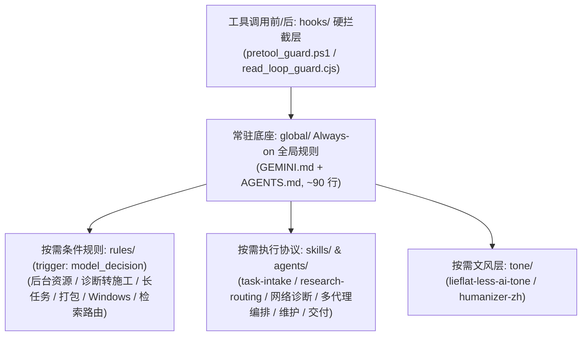

# Antigravity Agent Rules

这是一套给 Google Antigravity 桌面端（IDE / 2.0）& agy CLI 用的 Agent 分层规则、底层命令拦截 Hook、去 AI 味文风与按需 Skill 配置。

重度用 Agent 写代码或排障时，常会遇到它自作主张闯祸：诊断网络报错时顺手误杀本地代理软件、停掉 TUN 虚拟网卡服务或篡改系统代理注册表导致直接断网，或者误执行 `rm -rf`、`git reset --hard` 把未提交的代码抹掉。光在提示词里写“不许删文件、不许动代理”并不稳，上下文一长模型就会忘。这套配置把高危命令放到进程级 Hook 里硬拦，再把常驻规则、专项规则、文风和执行协议按层拆开按需加载。

除了防误删和防断网，它也管住另外几类常见毛病：根因确认后还反复读同一段代码不肯动刀，普通问答硬套故障排查模板或顺手改无关代码，拿示意图和伪代码冒充成品交差，只跑通一条静态路径就报全量验证通过（混淆 `VERIFIED` 与 `NOT_PROVEN`），随手拉起后台进程挂死终端或拿上千行构建日志刷爆主会话，在文档和脚本里带出 `C:\Users\<用户名>\...` 本机路径，以及写中文时满篇套话和翻译腔。

> 历史溯源：首版最早发在百度贴吧谷歌gemini吧（2026-09-29），之后由安钰在日常工程和长任务里不断改到现在这版。感谢 [LINUX DO 社区](https://linux.do/) 的开源交流氛围与佬友支持。

> [!WARNING]
> 使用前请注意以下四点边界：
> 1. **完整安装只支持 Windows（PowerShell 5.1 / pwsh 7）**，默认配合 Git Bash 使用。macOS / Linux 目前只支持 Hook 层：用 `./install.sh` 安装 Node 版拦截脚本 `pretool_guard.cjs`，见下文[macOS / Linux 只装 Hook](#macos--linux-只装-hook)。
> 2. **正则黑名单是安全网，不是沙箱，可以被绕过**。它用来拦住 Agent 常见的危险误操作，防不住换写法绕过或刻意构造的命令。
> 3. **用 Ask-First 审批模式的人注意，默认 allow 分支会自动放行非黑名单命令**。`pretool_guard.ps1` 对没命中黑名单的命令默认返回 `{"decision":"allow"}`，这是配合 Antigravity 的 `autoExecutionPolicy = EAGER (Turbo)` 设计的；如果你开的是每次手动审批（Ask-First），不要直接原样启用该分支。
> 4. 不要把本仓库所有 `.md` 文件拼接塞进同一个系统提示词（System Prompt / `GEMINI.md`）全量常驻。大模型有效注意力有限，全设为 `always_on` 不但白占数万 Token 推理空间，日常聊句简单问答也会触发繁琐的工程仪式并冲淡安全红线。正确用法是只让 `global/` 下约 90 行核心规则常驻，高危命令交给 `hooks/` 在进程级拦截（0 Token 开销），其余 `rules/`、`tone/` 和 `skills/` 由模型按场景触发读取。

---

## 快速安装与卸载

仓库根目录提供了纯 ASCII 编写的 [`install.ps1`](./install.ps1) 和 [`uninstall.ps1`](./uninstall.ps1)，兼容 Windows PowerShell 5.1 与 `pwsh` 7。

```powershell
# 一键安装并自动跑完 40 项 Hook 自检（自动化环境跳过确认可加 -Force）
powershell -NoProfile -ExecutionPolicy Bypass -File .\install.ps1

# 只装 Hook（防强删 + 代理/网络保护），不动 GEMINI.md、config.json 和规则/Skill/文风层
powershell -NoProfile -ExecutionPolicy Bypass -File .\install.ps1 -HookOnly

# 一键卸载并还原到安装前状态（同样支持 -Force）
powershell -NoProfile -ExecutionPolicy Bypass -File .\uninstall.ps1
```

`install.ps1` 按以下 5 步执行：
1. 校验：先解析现有 `~/.gemini/config/config.json` 与 `hooks.json` 语法，解析失败直接报错退出，不留半成品状态。
2. 确认：列出 `~/.gemini` 下即将被合并或覆盖的文件，等你输入 `y` 确认后才继续（默认否，加 `-Force` 可跳过）。
3. 备份：把安装前已存在的文件完整备份到 `~/.gemini/backup_antigravity_rules_<timestamp>/`，同时记录 `manifest.json`。
4. 无损合并：合并 `GEMINI.md` 与 `hooks.json`，替换路径占位符，分发 5 层文件并在 `config.json` 中启用 5 个插件。
5. 自检：自动运行 `python ~/.gemini/config/scripts/verify-hook.py` 验证 40 项断言全绿通过。

只想要拦截功能、不想换掉自己的规则，就用 `-HookOnly`：只合并 `hooks.json` 并部署 `scripts/`，第 4 步里的 `GEMINI.md`、插件和 `config.json` 全部跳过，自检照常运行。卸载时 `uninstall.ps1` 会从备份的 `manifest.json` 认出这是只装 Hook 的安装，只还原 `hooks.json` 和 `scripts/`。

<details>
<summary>点击展开：无损合并与占位符替换细节</summary>

- `GEMINI.md`：用 `<!-- antigravity-agent-rules:begin -->` 与 `<!-- antigravity-agent-rules:end -->` 标记包裹本仓库规则追加到文件末尾；若已有标记则只替换标记之间的内容，保留你原有的内容。
- `hooks.json`：按顶层键合并，只新增或替换 `hard-gate`、`read-loop-efficiency`、`read-loop-enforcement` 三个键，保留你原有的其他钩子配置。
- 路径占位符替换：把规则里的 `<YOUR_PATH>` 自动替换为当前用户的 `$env:USERPROFILE` 正斜杠路径；若传入 `-WorkspacePath "D:\MyProject"`，还会同步替换 `<YOUR_PROJECT_PATH>`。

</details>

`uninstall.ps1` 经 `y` 确认后，从最近一次 `~/.gemini/backup_antigravity_rules_*` 还原安装前已存在的文件，删掉安装时新建的脚本与插件目录，并在 `~/.gemini/config/config.json` 中只移除本仓库的 5 个插件条目（`anyi-global-rules`、`search-routing`、`docx-delivery`、`lieflat-less-ai-tone`、`humanizer-zh`），保留其余配置。

### macOS / Linux 只装 Hook

Mac 版 Antigravity 用的是同一套 hooks 协议：同样读 `~/.gemini/config/hooks.json`，payload 和 `{"decision": ...}` 返回格式一致，区别只是 hook 命令在 Unix 上经 `sh -c` 执行（Windows 上是 `cmd /c`）。所以 Hook 层可以等效搬过去，规则层、Skill 和文风层的安装脚本暂时还只有 Windows 版。

```bash
# 需要 Node.js >= 18；自检需要 python3（macOS 自带的即可）
./install.sh                 # 等价于 install.ps1 -HookOnly，加 --force 跳过确认
./uninstall.sh               # 从最近一次 hook-only 备份还原
```

和 Windows 版的区别：

- 拦截脚本换成 [`hooks/scripts/pretool_guard.cjs`](./hooks/scripts/pretool_guard.cjs)。前 29 条规则与 `pretool_guard.ps1` 逐条一致，另外补了 macOS / Linux 的规则：`diskutil erase*`、`dd of=/dev/`、`mkfs` / `newfs_*`、`tmutil delete`、`csrutil disable`；结束代理客户端（`kill` / `pkill` / `killall`、`launchctl bootout/unload`、`systemctl stop`、`osascript ... quit`，覆盖 ClashX、Clash Verge、mihomo、sing-box、Surge、Stash 等）；修改网络与系统代理（`networksetup -set*`、`ifconfig ... down`、`ipconfig set`、`route delete/flush/change`、`pfctl -d/-F`、`nmcli ... off/down`）。只读命令（`networksetup -get*`、`scutil --proxy`、`pgrep`、`launchctl list`、`diskutil list`）照常放行。
- 安装器会把 `hooks.json` 里的命令改写成 `"/opt/homebrew/bin/node" ./scripts/pretool_guard.cjs` 这种绝对路径形式。原因是从 Dock 启动的 Antigravity 不一定继承终端里的 PATH，直接写 `node` 可能找不到。
- PowerShell 5.1 的 GBK 编码问题在 macOS / Linux 上不存在：Node 版按原始字节读 stdin 并按 UTF-8 解码。
- 备份目录和 `manifest.json` 格式与 Windows 版相同（`mode: hook-only`）。`uninstall.sh` 只处理 hook-only 备份，完整安装请在 Windows 上用 `uninstall.ps1` 卸载。

---

## Hook 层重点说明

### 1. 拦什么

[`hooks/scripts/pretool_guard.ps1`](./hooks/scripts/pretool_guard.ps1) 挂载在 `PreToolUse` 上，每次 `run_command` 执行前同步触发，用正则黑名单硬拦两类命令：

- 高危删改与历史破坏：拦截递归强删文件目录、Git 强制回滚或强推、磁盘格式化与删注册表命令。
- 防止 Agent 诊断网络时误杀本地代理软件、TUN 虚拟网卡服务或篡改系统代理注册表：拦截结束本地代理进程、停止虚拟网卡服务、断网删路由及修改系统代理设置的命令（规则见 `pretool_guard.ps1` 第 105–114 行）。

<details>
<summary>点击展开：具体拦截命令清单</summary>

- 高危删改命令明细：递归强删（`Remove-Item -Recurse -Force` 及参数调换，`Remove-Item`/`ri`/`rm`/`del`/`erase`/`rd`/`rmdir` 搭配 `-r`/`-recurse` 与 `-fo`/`-force`，`rm -rf`、`rm -fr`、`rm -r -f`、`--recursive --force`，以及 `rd /s`、`rmdir /s`、`del /f`、`del /s`），Git 破坏性回滚与清理（`git reset --hard`、`git push --force`/`-f`、`git clean -fd`），磁盘格式化与初始化（`Format-Volume`、`format C:`、`Clear-Disk`、`Initialize-Disk`），以及删注册表（`Remove-Item HKLM:`、`reg delete`）。
- 网络与代理保护命令明细：结束本地代理软件进程（`taskkill`、`tskill`、`pkill`、`killall`、`Stop-Process`、`wmic process` 或 `.Kill()`）、停止或删除本地代理与 TUN 虚拟网卡服务（`sc stop/delete/config`、`net stop`、`Stop-Service`）、断开网卡或删路由（`netsh interface set interface`、`netsh wlan disconnect`、`Disable-NetAdapter`、`ipconfig /release`、`rasdial /d`、`route delete`），以及篡改系统代理注册表或 WinHTTP 代理（`reg add`、`Set-ItemProperty`、`New-ItemProperty`、`regedit` 操作 `Internet Settings`，或 `netsh winhttp set proxy`）。

</details>

命中黑名单时直接返回 `{"decision":"deny","reason":"HARD GATE: blocked - ..."}`，并写入 `hook_log.jsonl` 审计日志（超过 512 KB 自动轮转为 `.1`）。另外还有 [`hooks/scripts/read_loop_guard.cjs`](./hooks/scripts/read_loop_guard.cjs)（配合 [`read_loop_settings.json`](./hooks/scripts/read_loop_settings.json)），用来监测同一会话对未变更文件相同行号区间的重复读取（`repeatLimit: 3`），当前默认只跑在 `PostToolUse` 的 `observe` 模式，`enforce` 阻断模式尚未验证，标 `NOT_PROVEN`。

### 2. PS5.1 GBK 吞反斜杠导致静默放行的 Bug 与修复

因为同步 Hook 一旦抛错就会卡死整个 Agent 工具链，`pretool_guard.ps1` 的 `catch` 分支采用了 Fail-open 设计（内部报错时返回 `{"decision":"allow"}` 并记录 `ERROR-FAILOPEN`）。这在中文 Windows 的 PowerShell 5.1 下曾踩过一个隐蔽的编码坑。

Antigravity 往 Hook 的 `stdin` 发送的是原始 UTF-8 字节流，但中文 Windows 上的 PowerShell 5.1 默认用控制台 OEM 代码页（GBK / 936）解码 `[Console]::In`。载荷里一旦包含中文路径（例如 `C:\Users\<中文用户名>\...`），非 ASCII 字节就会被按 GBK 解乱，而紧跟在反斜杠 `\` 后面的字节可能被前一个字节吸进双字节 GBK 字符里，直接把合法的 JSON 转义吞掉，变成非法 JSON。`ConvertFrom-Json` 随即报错跳进 `catch` 分支，原本该被拦截的高危命令就这样被静默放行了。只用纯英文路径测试完全不会触发这个问题。

修复方式分两步：
1. 脚本源码本身保持纯 ASCII，避开 PowerShell 5.1 将无 BOM 脚本按 ANSI 解析时的非 ASCII 路径故障。
2. 不使用 `[Console]::In`，改用 `[Console]::OpenStandardInput()` 搭配显式的 `New-Object System.Text.UTF8Encoding($false)` 流解码器读取原始 `stdin`，输出时同样用 `UTF8Encoding($false)` 写回 `[Console]::OpenStandardOutput()`，绕开控制台 GBK 代码页。

### 3. 40 项回归自检（`verify-hook.py`）

每次修改 `pretool_guard.ps1` 后，运行 [`hooks/scripts/verify-hook.py`](./hooks/scripts/verify-hook.py) 即可跑完 40 项回归校验：

```bash
python ~/.gemini/config/scripts/verify-hook.py
```

自检脚本会把带中文用户名路径（`C:\Users\测试用户\...`）的真实 UTF-8 JSON 载荷通过 `stdin` 喂给 `powershell.exe`，覆盖 [`test-cases.txt`](./hooks/scripts/test-cases.txt) 的 16 项高危删改与常规命令、2 项中文路径编码回归用例、16 项本地代理与网络保护用例（13 项 `deny` + 3 项只读探测 `allow`），以及 6 项正常命令无状态重复放行用例。跑完除了要求 `TOTAL 40 / PASS 40 / FAIL 0`，还会检查 `hook_log.jsonl` 中的 `ERROR-FAILOPEN` 计数必须为 `0`，确认没有任何命令是因为解析失败被放行的。

在 macOS / Linux 上（或在 Windows 上加 `--guard node`）运行时，自检对象换成 `pretool_guard.cjs`，并额外跑 SECTION 5 的 38 项 macOS / Linux 用例（27 项 `deny` + 11 项只读或普通命令 `allow`），合计 `TOTAL 78`：

```bash
python3 ~/.gemini/config/scripts/verify-hook.py              # macOS / Linux 默认测 Node 版
python verify-hook.py --guard node                            # Windows 上测 Node 版
```

---

## 五层架构



- `hooks/`（硬拦截层）：在工具调用前后由宿主直接调用，不占模型上下文 Token。`pretool_guard.ps1` 在进程级拦住强删、丢代码和杀代理断网命令，`read_loop_guard.cjs` 在 `observe` 模式下记录重复读同一文件区间的死循环。
- `global/`（Always-on 常驻底座）：只有 `GEMINI.md` 和 `AGENTS.md` 两个文件常驻，共约 90 行。规定防开盒与路径脱敏、代理只读红线、Git Bash / `pwsh` 7 偏好、动作分级、`FAST_PATH` / `INVESTIGATION_PATH` 切换、证据分级（`VERIFIED` / `NOT_PROVEN` / `HYPOTHESIS`）以及专项规则路由。
- `rules/`（按需条件规则层）：带 `trigger: model_decision`，平时只向模型暴露一行触发条件描述。仅在涉及后台进程与 GUI 脱钩、诊断转施工判断、8 分钟长任务阶段汇报、打包发布、Windows 脚本编码或外部联网检索时按需加载。
- `skills/` 与 `agents/`（按需执行协议与子代理层）：存放多步骤工程状态机与四态回报（`task-intake`）、多源检索（`research-routing`）、只读网络排查（`safe-network-diagnostics`）、多代理编排（`multi-agent-orchestrator`）、客户端缓存归档（`client-maintenance`）、Word 转换校验（`docx-delivery`）和小说创作（`chinese-novelist`）等标准作业程序，同时提供运行在 Gemini Flash 上的全局只读验证子代理 `flash-verifier.md` 来隔离长日志与哈希扫描脏活。
- `tone/`（按需文风层）：包含 `lieflat-less-ai-tone`（基于 283 万字语料统计的 11 条去 AI 味规范）和 `humanizer-zh`（去除空话、重复与模板腔）。平时问答与写代码不加载，只在创作或润色中文文章及用户点名去 AI 味时读取。

---

## 完整文件总表与手动部署步骤

<details>
<summary>点击展开：完整文件总表（27 项文件与触发矩阵）</summary>

| 仓库内路径 | 原始部署路径（脱敏） | 所属层级 | 触发方式 | 一句话作用 |
| :--- | :--- | :--- | :--- | :--- |
| [`install.ps1`](./install.ps1) | 仓库根目录执行（一键部署入口） | 自动化部署 (`root`) | 手动执行（首次安装或更新规则时） | 预先校验 `config.json`/`hooks.json` 语法、列出待修改项并经 `y` 确认（支持 `-Force`）、自动备份原配置、替换 `<YOUR_PATH>`、按标记/顶层键无损合并 `GEMINI.md` 与 `hooks.json`、分发 5 层文件、启用 5 个插件并跑通 `verify-hook.py` 自检。 |
| [`uninstall.ps1`](./uninstall.ps1) | 仓库根目录执行（一键卸载回滚） | 自动化部署 (`root`) | 手动执行（卸载或还原配置时） | 经 `y` 确认后（支持 `-Force`），从最近一次 `backup_antigravity_rules_*` 还原安装前已存在的文件，删除安装前不存在的文件与插件目录，并仅从 `config.json` 移除本仓库的 5 个插件条目。 |
| [`install.sh`](./install.sh) / [`uninstall.sh`](./uninstall.sh) + [`hooks/unix/hooks-installer.mjs`](./hooks/unix/hooks-installer.mjs) | 仓库根目录执行（macOS / Linux） | 自动化部署 (`root`) | 手动执行（只装或卸载 Hook 层时） | 等价于 `install.ps1 -HookOnly` / `uninstall.ps1` 的 hook-only 分支：预校验 `hooks.json`、`y` 确认（支持 `--force`）、备份、按顶层键合并并把命令改写为 Node 绝对路径、部署 `scripts/`、跑 `verify-hook.py --guard node`。 |
| [`hooks/hooks.json`](./hooks/hooks.json) | `~/.gemini/config/hooks.json` | 硬拦截 Hook (`hooks/`) | `PreToolUse` (`run_command`) / `PostToolUse` (读写检索工具) | 注册 `hard-gate` 危险命令硬拦截与 `read-loop` 重复读取检测钩子。 |
| [`hooks/scripts/pretool_guard.ps1`](./hooks/scripts/pretool_guard.ps1) | `~/.gemini/config/scripts/pretool_guard.ps1` | 硬拦截 Hook (`hooks/`) | `PreToolUse`（每次 `run_command` 执行前同步触发） | 底层正则硬拦截递归强删（含 `rm -r -f`、`--recursive --force`、PowerShell `rm/ri -r -fo` 等）、`git reset --hard`/`push --force`、删注册表/格式化，以及杀代理进程、停 TUN 服务、断网或改系统代理命令（UTF-8 流解码 + Fail-open 审计日志）。 |
| [`hooks/scripts/pretool_guard.cjs`](./hooks/scripts/pretool_guard.cjs) | `~/.gemini/config/scripts/pretool_guard.cjs` | 硬拦截 Hook (`hooks/`) | `PreToolUse`（macOS / Linux 安装时挂载） | `pretool_guard.ps1` 的 Node 跨平台版：29 条 Windows 规则逐条一致，另加 macOS / Linux 的磁盘、代理客户端与网络设置规则；同样 Fail-open 并写 `hook_log.jsonl`。 |
| [`hooks/scripts/read_loop_guard.cjs`](./hooks/scripts/read_loop_guard.cjs) | `~/.gemini/config/scripts/read_loop_guard.cjs` | 硬拦截 Hook (`hooks/`) | `PostToolUse`（默认 `observe`）/ `PreToolUse`（`enforce` 未启用） | 监测同一会话内对未变更文件相同行号区间的重复读取。默认仅运行在 `observe`（诊断观察）模式；`enforce`（阻断拦截）模式尚未验证（`read_loop_settings.json` 中 `nativeCoverageVerified`、`rangeOutputVerified`、`permissionPolicyVerified` 三个 Verified 标志均为 `false`），标 `NOT_PROVEN`。 |
| [`hooks/scripts/read_loop_settings.json`](./hooks/scripts/read_loop_settings.json) | `~/.gemini/config/scripts/read_loop_settings.json` | 硬拦截 Hook (`hooks/`) | 被 `read_loop_guard.cjs` 读取 | 配置重复读取检测模式（默认 `"mode": "observe"`，三个 Verified 标志均为 `false`，`enforce` 模式 `NOT_PROVEN`）与重复次数上限（`repeatLimit: 3`）。 |
| [`hooks/scripts/verify-hook.py`](./hooks/scripts/verify-hook.py) + [`test-cases.txt`](./hooks/scripts/test-cases.txt) | `~/.gemini/config/scripts/` | 硬拦截 Hook (`hooks/`) | 手动执行（修改 `pretool_guard.ps1` 后运行自检） | 用含中文路径的真实 UTF-8 载荷、高危删改命令集与 代理/网络保护规则集（第 105–114 行）对 `pretool_guard.ps1` 做 40 项全量回归校验，确保拦截准确且无编码破损导致的静默放行。 |
| [`global/GEMINI.md`](./global/GEMINI.md) | `~/.gemini/GEMINI.md` | Always-on 全局规则 (`global/`) | `always_on`（所有会话自动注入） | 定义人机协作态度、防开盒与路径脱敏铁律、用户代理与网络配置严格只读红线、Git Bash/pwsh 7 偏好、子代理派工原则与可选共享待办入口。 |
| [`global/AGENTS.md`](./global/AGENTS.md)（含 [`plugin.json`](./global/plugin.json)） | `~/.gemini/config/plugins/anyi-global-rules/rules/AGENTS.md` | Always-on 全局规则 (`global/`) | `trigger: always_on` | 全局工程主规则（§1–§15）：规定动作分级、`FAST_PATH`/`INVESTIGATION_PATH` 轮次纪律、禁仪式化严谨、停止与资源边界、交付契约、证据真实性、数据保护、范围锁定及按需专项路由。 |
| [`tone/lieflat-less-ai-tone/`](./tone/lieflat-less-ai-tone/skills/lieflat-less-ai-tone/SKILL.md) | `~/.gemini/config/plugins/lieflat-less-ai-tone/` | 文风层 (`tone/`) | 按需加载（创作或润色中文文章/文案/故事、或明确要求去 AI 味时；普通问答不加载） | 基于 283 万字语料统计的 11 条去 AI 味写作规范（与全局规则衔接版），清除宏大拔高、三连排比、翻译腔与连接词泛滥，严守事实与结构守恒（上游完整仓库见 [`UPSTREAM.md`](./tone/lieflat-less-ai-tone/UPSTREAM.md)）。 |
| [`tone/humanizer-zh/`](./tone/humanizer-zh/skills/humanizer-zh/SKILL.md) | `~/.gemini/config/plugins/humanizer-zh/` | 文风层 (`tone/`) | 按需加载（编辑或审阅已有中文文章/评论/文档、去除空话与模板化表达时） | 消除已有中文文本的空话、重复与模板腔，严格保留原文事实、确定程度与作者声音（上游仓库见 [`UPSTREAM.md`](./tone/humanizer-zh/UPSTREAM.md)）。 |
| [`rules/BACKGROUND-RESOURCES.md`](./rules/BACKGROUND-RESOURCES.md) | `~/.gemini/config/plugins/anyi-global-rules/rules/BACKGROUND-RESOURCES.md` | 按需 model-decision 规则 (`rules/`) | `trigger: model_decision`（创建/管理临时子代理、后台任务、测试服、子进程或拉起桌面 GUI 前） | 规定“谁创建谁负责生命周期”、创建记身份、探针用完即杀、桌面 GUI 脱钩启动，禁止按进程名盲杀用户原有服务。 |
| [`rules/IMPLEMENTATION.md`](./rules/IMPLEMENTATION.md) | `~/.gemini/config/plugins/anyi-global-rules/rules/IMPLEMENTATION.md` | 按需 model-decision 规则 (`rules/`) | `trigger: model_decision`（判断证据是否已收敛、能否从诊断转入施工时） | 细化全局 §2A 诊断→施工切换条件，区分故障修复根因证据与新增功能现状/目标证据，防止只读调查空转。 |
| [`rules/LONG-TASKS.md`](./rules/LONG-TASKS.md) | `~/.gemini/config/plugins/anyi-global-rules/rules/LONG-TASKS.md` | 按需 model-decision 规则 (`rules/`) | `trigger: model_decision`（距上次用户可见正文接近 8 分钟，或长任务卡点/重复失败时） | 细化全局 §4A 长任务阶段可见性（8 分钟墙钟阈值 / 60 次工具调用兜底），规范阶段汇报内容且不打断正常执行。 |
| [`rules/RELEASE-PACKAGING.md`](./rules/RELEASE-PACKAGING.md) | `~/.gemini/config/plugins/anyi-global-rules/rules/RELEASE-PACKAGING.md` | 按需 model-decision 规则 (`rules/`) | `trigger: model_decision`（构建、修改或验收 Release / 便携包 / 交付 ZIP 前） | 规定冻结基线定义、完整依赖闭包检查、独立新目录解压实跑验证与五态发布结论。 |
| [`rules/RULE-MAINTENANCE.md`](./rules/RULE-MAINTENANCE.md) | `~/.gemini/config/plugins/anyi-global-rules/rules/RULE-MAINTENANCE.md` | 按需 model-decision 规则 (`rules/`) | `trigger: model_decision`（新增、修改或评估本套全局治理规则时） | 细化全局 §14 规则冻结原则：禁止为单一失败样本扩写规则，明确新增条款必须同时满足的三项门槛。 |
| [`rules/WINDOWS-RELEASE.md`](./rules/WINDOWS-RELEASE.md) | `~/.gemini/config/plugins/anyi-global-rules/rules/WINDOWS-RELEASE.md` | 按需 model-decision 规则 (`rules/`) | `trigger: model_decision`（制作、修改或验证 Windows 脚本与中文交付物前） | 规范 BAT/CMD 纯 ASCII 编码、中文 TXT UTF-8 BOM 约定，以及启动/关闭脚本用目标解释器实跑验证的要求。 |
| [`rules/SEARCH-ROUTING.md`](./rules/SEARCH-ROUTING.md) | `~/.gemini/config/plugins/search-routing/rules/SEARCH-ROUTING.md` | 按需 model-decision 规则 (`rules/`) | `trigger: model_decision`（涉及时效信息、外部事实核验、库版本状态、官方文档或 URL 读取时） | 决定何时必须用 `search_web` 检索、何时用 `read_url_content` 直取、何时才用 Browser Agent 及失败降级规则。 |
| [`skills/task-intake/SKILL.md`](./skills/task-intake/SKILL.md) | `~/.gemini/config/plugins/anyi-global-rules/skills/task-intake/SKILL.md` | 按需 Skill (`skills/`) | 多步骤工程开发、复杂排障（`INVESTIGATION_PATH`）、生产变更、触发熔断或输出四态工程回报时 | 承载工程任务内部编译、状态标记总表（原全局 §7A）、只读空转熔断、独立 Review 与四态交付回报（`PASS`/`PASS_WITH_NOTES`/`BLOCKED`/`FAIL`）。 |
| [`skills/research-routing/SKILL.md`](./skills/research-routing/SKILL.md) | `~/.gemini/config/plugins/search-routing/skills/research-routing/SKILL.md` | 按需 Skill (`skills/`) | 触发 `SEARCH-ROUTING` 且需执行外部检索与多源核验时 | 规定双语查询构造、来源三级分类与交叉验证强度（第三方至少 2 独立源）、官方原文抓取与时效 `as-of` 标注 SOP。 |
| [`skills/safe-network-diagnostics/SKILL.md`](./skills/safe-network-diagnostics/SKILL.md) | `~/.gemini/config/plugins/anyi-global-rules/skills/safe-network-diagnostics/SKILL.md` | 按需 Skill (`skills/`) | 网络连通性排查、代理状态检查、DNS/端口探测或接口报错诊断时 | 固化用户代理只读红线，提供进程、端口、环境变量、连通性四步纯只读网络诊断命令规范。 |
| [`skills/multi-agent-orchestrator/SKILL.md`](./skills/multi-agent-orchestrator/SKILL.md) | `~/.gemini/config/plugins/anyi-global-rules/skills/multi-agent-orchestrator/SKILL.md` | 按需 Skill (`skills/`) | 子代理分工、派 Flash 干只读验证/脏活、跨模块检索、隔离实验或跨端 MCP 协同任务时 | 规范主会话上下文保护、内部 Subagent 模型/工作区选型（默认派 Flash 干只读活）、派工 Prompt 结构与跨端 MCP 协同纪律。 |
| [`skills/client-maintenance/SKILL.md`](./skills/client-maintenance/SKILL.md) | `<workspace>/.agents/skills/client-maintenance/SKILL.md` | 按需 Skill (`skills/`) | 清理 Antigravity 缓存、维护客户端存储空间或归档陈旧历史会话时 | 执行 7 天活跃会话与当前会话白名单保护、14 天以上陈旧会话压缩归档至 `_archives/` 并校验、以及临时渲染缓存安全释放。 |
| [`skills/docx-delivery/`](./skills/docx-delivery/skills/docx-delivery/SKILL.md) | `~/.gemini/config/plugins/docx-delivery/` | 按需 Skill (`skills/`) | 用户要求将 Markdown/文本/报告转换为可编辑的 Word (`.docx`) 成品时 | 提供两条实战验证的转换链（纯标准库无图版 `md2docx_one.py` / 带图版 `md2docx_img.py`）与防覆盖保护、结构校验脚本 `validate_docx.py`。 |
| [`skills/chinese-novelist/`](./skills/chinese-novelist/SKILL.md) | `<workspace>/.agents/skills/chinese-novelist/` | 按需 Skill (`skills/`) | 用户要求分章节创作中文中长篇小说（10–50 章）或续写小说项目时 | 与全局规则（§4A 阶段汇报、覆盖前备份、`lieflat-less-ai-tone` 自检）衔接的小说创作入口（上游完整流程与脚本见 [`UPSTREAM.md`](./skills/chinese-novelist/UPSTREAM.md)）。 |
| [`agents/flash-verifier.md`](./agents/flash-verifier.md) | `~/.gemini/config/plugins/anyi-global-rules/agents/flash-verifier.md` | 按需全局 Subagent (`agents/`) | `invoke_subagent(TypeName="flash-verifier")`（跑只读扫描、核对哈希、筛长日志时委派） | 运行在 Gemini Flash 上的全局只读验证专员定义，强制纯只读、单条回复 ≤40 行、大输出落盘 `scratch/`。 |

</details>

<details>
<summary>点击展开：按层手动部署步骤</summary>

若需手动选择性部署，请先将文件中标注的 `<YOUR_PATH>`、`<YOUR_PROJECT_PATH>` 等占位符替换为你本机的实际路径（或直接改用 `~` 相对路径）。

> 关于 `global/AGENTS.md` 内相对链接的说明：`global/AGENTS.md` 中的 `./IMPLEMENTATION.md`、`../skills/task-intake/SKILL.md` 等相对链接是按部署后的运行目录层级（`~/.gemini/config/plugins/anyi-global-rules/rules/AGENTS.md`）编写的，部署后完全正确；在 GitHub 网页端直接浏览仓库内 `global/AGENTS.md` 时因仓库按层分目录（`global/` 与 `rules/`、`skills/` 分离）点击会打不开，属正常现象。

#### 1. 底层硬拦截层（`hooks/`）
- 目标位置：
  - 将 `hooks/hooks.json` 放入 `~/.gemini/config/hooks.json`
  - 将 `hooks/scripts/*` 放入 `~/.gemini/config/scripts/`
- 路径与环境要求：
  - `hooks.json` 中的 `hard-gate` 与 `read-loop` 已统一使用基于 `hooks.json` 所在目录（`~/.gemini/config/`）的相对路径 `./scripts/pretool_guard.ps1` 与 `./scripts/read_loop_guard.cjs`（已在本机实测验证生效）。
  - `read-loop` 直接调用 `node` 命令，要求 `node`（Node.js）已加入系统 `PATH` 环境变量。
- 启用与验证：
  - 在终端运行自检脚本验证拦截器工作正常（共 40 项断言，含高危删改、中文路径编码回归、杀代理进程/停代理服务/改系统代理注册表拦截与无状态放行验证）：
    ```bash
    python ~/.gemini/config/scripts/verify-hook.py
    ```

#### 2. Always-on 全局规则层（`global/`）
- 目标位置：
  - `global/GEMINI.md` → 复制到 `~/.gemini/GEMINI.md`
  - `global/plugin.json` → 复制到 `~/.gemini/config/plugins/anyi-global-rules/plugin.json`
  - `global/AGENTS.md` → 复制到 `~/.gemini/config/plugins/anyi-global-rules/rules/AGENTS.md`
- 启用方式：
  - `~/.gemini/GEMINI.md` 会被 Antigravity / Gemini 自动作为全局最高优 `user_global` 规则注入。
  - 在 `~/.gemini/config/config.json` 的 `"plugins"` 字段下启用插件：
    ```json
    "anyi-global-rules": {
      "enabled": true
    }
    ```

#### 3. 按需 `model_decision` 专项规则层（`rules/`）
- 目标位置：
  - `BACKGROUND-RESOURCES.md`、`IMPLEMENTATION.md`、`LONG-TASKS.md`、`RELEASE-PACKAGING.md`、`RULE-MAINTENANCE.md`、`WINDOWS-RELEASE.md` → 放入 `~/.gemini/config/plugins/anyi-global-rules/rules/`
  - `SEARCH-ROUTING.md` → 放入 `~/.gemini/config/plugins/search-routing/rules/SEARCH-ROUTING.md`（并将 `rules/search-routing.plugin.json` 命名为 `~/.gemini/config/plugins/search-routing/plugin.json`，在 `config.json` 中设为 `"enabled": true`）
- 启用方式：
  - 这些文件顶部均带有 YAML Frontmatter `trigger: model_decision` 与精确的 `description`。Antigravity 平时只向模型暴露一行触发描述，仅当任务命中条件时由模型按需调用 `read_file` 加载全文。

#### 4. 按需 Skill 与全局 Subagent 层（`skills/` & `agents/`）
- 目标位置：
  - `task-intake/`、`safe-network-diagnostics/`、`multi-agent-orchestrator/` → 放入 `~/.gemini/config/plugins/anyi-global-rules/skills/`
  - `research-routing/` → 放入 `~/.gemini/config/plugins/search-routing/skills/research-routing/`
  - `docx-delivery/` → 原样放入 `~/.gemini/config/plugins/docx-delivery/`（目录内已按 `plugin.json` + `skills/docx-delivery/SKILL.md` + `skills/docx-delivery/scripts/` 标准插件层级组织，在 `config.json` 中启用即可）
  - `client-maintenance/`、`chinese-novelist/` → 可放入工作区 `.agents/skills/` 或全局 `~/.gemini/antigravity/skills/`（注：`chinese-novelist` 需先按其 `UPSTREAM.md` 拉取上游 `references/` 与 `scripts/`）
  - `agents/flash-verifier.md` → 放入 `~/.gemini/config/plugins/anyi-global-rules/agents/flash-verifier.md`

#### 5. 去 AI 味文风层（`tone/`）
- 目标位置：
  - `tone/lieflat-less-ai-tone/` → 原样放入 `~/.gemini/config/plugins/lieflat-less-ai-tone/`（目录内已按 `plugin.json` + `skills/lieflat-less-ai-tone/SKILL.md` 标准插件层级组织）
  - `tone/humanizer-zh/` → 原样放入 `~/.gemini/config/plugins/humanizer-zh/`（目录内已按 `plugin.json` + `skills/humanizer-zh/SKILL.md` 标准插件层级组织）
- 启用方式：
  - 在 `~/.gemini/config/config.json` 中将 `"lieflat-less-ai-tone"` 与 `"humanizer-zh"` 设为 `"enabled": true`。平时问答不触发，仅在写作、成稿润色或用户点名“去 AI 味”时按需读取。

</details>

---

## 可选：跨端 MCP 桥（`mcp/`）

前面几层管的是「本机这个 Agent 怎么做事」。如果你还想让 Antigravity 把活派给**另一个** Agent，`mcp/` 下有两条路，取舍很明确：

| | [`mcp/dsh-crew`](./mcp/dsh-crew/) | [`mcp/agent-bridge`](./mcp/agent-bridge/) |
|---|---|---|
| 后端 | 绑死 DSH（`dsh --profile headless`） | 可插拔（`BRIDGE_CMD` 指谁就是谁） |
| 工具 | `dsh_ask` / `dsh_sessions` / `dsh_status` / `dsh_forget` | `agent_ask` / `agent_sessions` / `agent_status` / `agent_forget` |
| 验证 | **真机跑通 6/6**，含续聊复用同一 session | 假后端 **32/32** 协议断言，**未接任何真实后端** |
| 来历 | DSH 自身按需求生成，会话可溯 | 作者原创编写 |
| 适合 | 就想接 DSH | 后端要换，只想要一层薄封装 |

两者都是单文件、零依赖、只用 Node 内建模块，**不含任何第三方项目的代码**；任务都走 stdin 送入，避开引号/换行/中文标点的二次转义。

- 最快自检：`node mcp/dsh-crew/verify.mjs --offline`（不启动后端、不花 token）
- 环境变量表、Antigravity 注册样例、凭据补丁占位机制与已知限制见各自目录的 README；两边的 README 顶部都标了来历与验证状态，**别把「未验证」当「已验证」用**。
- 编排侧怎么用：`skills/multi-agent-orchestrator/SKILL.md` §4 里的 `<YOUR_HEADLESS_MCP>` 占位符，填这两座桥中的任一个即可，工具名对应关系写在该节表格里。


---

## 适配的模型版本

- 已在本机实测验证的模型（`VERIFIED`）：
  - 主力推理与施工模型（Main Agent / `Model: "inherit"`）：
    - Gemini 4 Argon（`High` / `Medium` / `Low`）
    - Claude Opus 5.5（`High` / `Medium`）
  - 只读验证与脏活子代理模型（Subagent / `flash-verifier`）：
    - Gemini 3.8 Flash（`High` / `model: flash` 3.8f），专职承担高频只读扫描、SHA-256 哈希核对、长篇日志筛查与广度代码搜索，将海量中间输出隔离在子会话内，只向主会话返回 ≤40 行的结构化结论与 `文件:行号`。
- 理论上兼容，未实测（`NOT_PROVEN`）：
  - Gemini 3.1 Pro、Claude Sonnet 4.6 / Opus 4.6、GPT-5.4 / Codex 等其他支持 Rules / Skills / Lifecycle Hooks 协议的同类模型。

---

## 已知限制

1. 宿主操作系统与 Shell 假定：
   - `hooks/scripts/pretool_guard.ps1` 与 `WINDOWS-RELEASE.md` 主要针对 Windows 10/11（中文环境 PowerShell 5.1 / pwsh 7 + Git Bash）编写与实测。macOS / Linux 下的 Hook 层由 `install.sh` 安装 Node 版 `pretool_guard.cjs`，规则层、Skill 与文风层的安装脚本目前只有 Windows 版。
2. Turbo 自动执行策略下的 Hook 行为说明：
   - `pretool_guard.ps1` 对未命中黑名单的命令默认返回 `{"decision":"allow"}`，这与 Antigravity 开启 `autoExecutionPolicy = EAGER (Turbo)` 的行为一致。如果你在客户端使用的是“每次执行命令前手动审批（Ask-First）”策略，请勿直接原样启用该 Hook 的默认 `allow` 分支，否则它会替你自动放行非黑名单命令。
3. `read_loop_guard.cjs` 的 `enforce` 拦截模式尚未验证（`NOT_PROVEN`）：
   - `read_loop_guard.cjs` 当前默认配置为 `"mode": "observe"`（仅在 `PostToolUse` 记录重复读取诊断，不阻断工具调用）；`read_loop_settings.json` 中的 `nativeCoverageVerified`、`rangeOutputVerified`、`permissionPolicyVerified` 三个 Verified 标志均为 `false`，且 `hooks.json` 中 `read-loop-enforcement` 默认为 `"enabled": false`。
4. 软规则不能替代硬权限：
   - Markdown 规则层（`global/`、`rules/`、`skills/`）本质上是模型行为约束与上下文协议，受限于大模型自身的注意力波动，极端情况下仍可能出现遗漏；高危红线（防强删、防杀代理、防断网）必须配合 `hooks/pretool_guard.ps1` 进程级硬拦截共同使用。
5. 第三方引用 Skill 的完整度：
   - `tone/lieflat-less-ai-tone`、`tone/humanizer-zh` 与 `skills/chinese-novelist` 仅收录了与本套全局规则衔接的 `SKILL.md` 及原项目 MIT `LICENSE`，未打包原仓库的配图、语料统计表与辅助脚本；如需完整资产请按各目录下的 `UPSTREAM.md` 指引从原仓库拉取。

---

## 开源协议与致谢

- 本仓库原创规则、脚本与架构文档采用 [MIT License](./LICENSE) 开源（Copyright (c) 2026 安钰）。
- `tone/` 与 `skills/chinese-novelist/` 下引用的第三方开源 Skill 均遵循各自收录版本的 MIT License，详见对应子目录下的 `LICENSE` 与 `UPSTREAM.md`：
  - [`lieflat-less-ai-tone`](https://github.com/larashero3-dotcom/lieflat-less-ai-tone) — Copyright (c) 2026 shiujan。**本仓库 `tone/lieflat-less-ai-tone/` 目录基于上游 V1（283 万字版，2026-08-20 首次提交，收录时对应上游 commit 哈希 [`27d29232f10124db904ca9c0536d0b67cb3b2833`](https://github.com/larashero3-dotcom/lieflat-less-ai-tone/tree/27d29232f10124db904ca9c0536d0b67cb3b2833)，当时为 MIT License）。上游已于 2026-10-27 发布 V2 并改为 CC BY-NC 4.0，从上游拉取的新版不适用 MIT、不可商用。**
  - [`humanizer-zh`](https://github.com/op7418/Humanizer-zh) / [`blader/humanizer`](https://github.com/blader/humanizer) — 分别保留上游 `LICENSE` 原文（`Copyright (c) 2026 歸藏`，MIT）与 `LICENSE.blader` 原文（`Copyright (c) 2025 Siqi Chen`，MIT）。
  - [`chinese-novelist-skill`](https://github.com/PenglongHuang/chinese-novelist-skill) — 对照上游 `master` 分支保留 `LICENSE` 原文（`Copyright (c) 2026 PenglongHuang`，MIT）。
- 社区致谢：本项目认可并致谢 [LINUX DO 社区](https://linux.do/)（[https://linux.do](https://linux.do)），感谢社区佬友在 AI Agent 工程实践与工具链上的交流分享。
